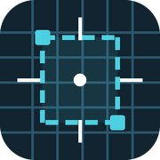
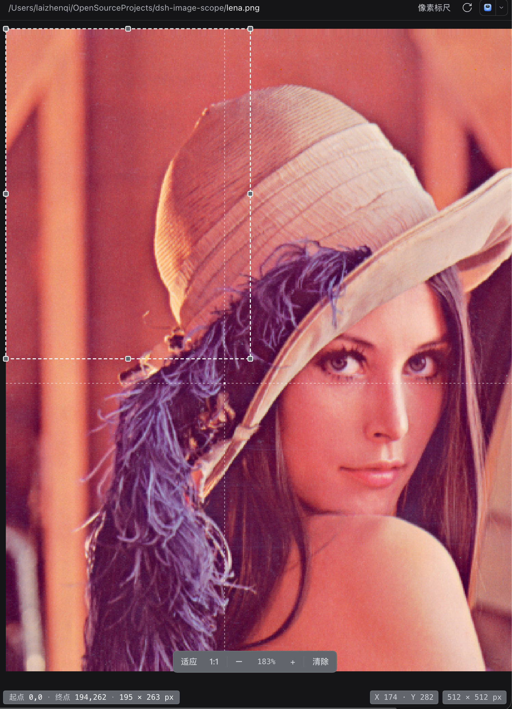

> **开发说明 / Development:** 本分支用于展示与发布说明；如需开发请切到 [`release`](https://github.com/olivine13/dsh-image-scope/tree/release) 分支。 / This branch is the landing page; switch to the `release` branch for development.

<p align="center"></p>

# dsh-image-scope

[中文](README.zh.md) · [GitHub](https://github.com/olivine13/dsh-image-scope) · [Issues](https://github.com/olivine13/dsh-image-scope/issues) · [npm](https://www.npmjs.com/package/dsh-image-scope)

A pixel ruler for the DeepSeek Harness (DSH) sidebar image preview. Hover to read the pixel under the pointer, drag one dashed rectangle to measure a region, and keep every measurement in true image pixels at any zoom level.

Built for development and design checks: compare screenshots, verify spacing, measure icon sizes, or inspect a single pixel.

## Screenshot

<p align="center"></p>

A dashed selection from `(0,0)` to `(194,262)`, measured as **195 × 263 px** in the bottom-left bar. The pointer is at `X 174 / Y 282`; the image is **512 × 512 px** and is being viewed at **183%**. Measurements stay in image pixels at any zoom.

## Features

- **Hover coordinates** — the bottom-right bar shows X/Y, with a crosshair and a highlighted pixel cell.
- **One measuring rectangle** — drag to draw a dashed box; drag inside it to move, or use the eight handles to resize. Every edge snaps to the image bounds.
- **Readable measurements** — the bottom-left bar shows the start pixel, end pixel, and `width × height` in whole image pixels.
- **Keyboard** — Ctrl+D (⌘D on macOS) clears the box while the viewer has focus; Esc cancels a draw, move, or resize in progress.
- **Zoom-aware** — Fit / 1:1 / − / + and Ctrl/⌘ + wheel (or trackpad pinch). Wheel zoom is anchored at the pointer and toolbar zoom at the viewport center; coordinates and sizes stay in image pixels, not screen pixels.
- **Pixel-accurate rendering** — images switch to pixelated rendering at 150% and above.
- **Keeps the built-in viewer** — the stock Image viewer is still available in the viewer dropdown.
- **Configurable** — colors, font sizes, box metrics, and overlay styles live in `config.json`.

## Install

```sh
dsh plugin add dsh-image-scope
```

Add `--profile <name>` if you are not on the default profile. You can also install it from **Plugins → Discover** once the marketplace entry is published.

The package is also on npm: [dsh-image-scope](https://www.npmjs.com/package/dsh-image-scope).

- `npm install dsh-image-scope` downloads the package but does not register the plugin in DSH.
- Use `dsh plugin add dsh-image-scope` (above) to enable it in a profile.
- Host entry: `import { apply } from 'dsh-image-scope'`. DSH loads the browser half from `dsh-image-scope/client` through the bundle manifest.

## Usage

1. Open an image in the right sidebar (PNG, JPEG, GIF, WebP, BMP, ICO, or SVG).
2. Pick **Pixel Scope** in the viewer dropdown if it is not already selected. It is the default viewer for images.
3. Move the pointer over the image to read coordinates.
4. Drag to draw the dashed rectangle.
5. Drag inside the rectangle to move it; drag a corner or edge handle to resize it. Edges snap to the image boundaries.
6. Press Ctrl+D / ⌘D, click **Clear**, or draw a new box to replace it.

Coordinates are zero-based from the top-left pixel. Width and height count whole pixels, including both ends, so a box from x=100 to x=199 is 100 px wide.

## Configuration

Edit `config.json` in the plugin package. The sections are:

| Section | What it controls |
|---|---|
| `font` | font families, font sizes, line heights |
| `canvas` | canvas background and text color, scroll padding, focus ring |
| `selection` | dashed box stroke, width, dash pattern, fill, fill opacity |
| `crosshair` | hover crosshair color, opacity, width, dash |
| `pixel` | hovered pixel cell outline |
| `handle` | the eight resize handles: size, radius, fill, stroke |
| `selectionInfo` | bottom-left measurement bar: position, width, spacing, padding, colors |
| `hud` | bottom-right hint/size bar: position, width, spacing, colors |
| `toolbar` | zoom toolbar and its buttons, value, separator |
| `status` | loading and error text |

The Host reads the file on each page boot and injects it into the browser. After editing, refresh the page. A page that was already open before the plugin was first enabled uses an embedded default style until it is refreshed; the injected file wins afterwards. If edits still do not apply after a refresh, restart DSH once so the Host half reloads.

## Compatibility

- DSH: `>=0.2.1-rc.5 <0.3.0-0 || >=0.2.2-rc.1 <0.3.0-0` (tested on `0.2.1-rc.5`)
- No build step, no runtime dependencies, no install scripts.

The viewer uses the document-preview extension point and the `sidebar.right.tab.document` slot. If the built-in document preview is unavailable, the viewer is not mounted.

## Privacy

Everything runs locally. The plugin reads only its own `config.json` and the image bytes the preview already provides; it does not send data anywhere and does not access credentials.

## Development

Plain JavaScript, no build step.

The source, tests, and runtime files live on the [`release`](https://github.com/olivine13/dsh-image-scope/tree/release) branch; this branch keeps the landing page and release assets.

| Path | Purpose |
|---|---|
| `client.js` | browser viewer, config merge, generated stylesheet |
| `index.js` | Host half that injects `config.json` into the page |
| `config.json` | colors, sizes, boxes, overlay |
| `test/math-test.mjs` | pixel mapping, snapping, hit-testing, move/resize tests |

```sh
npm test
```

## License

MIT
