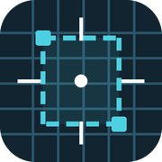
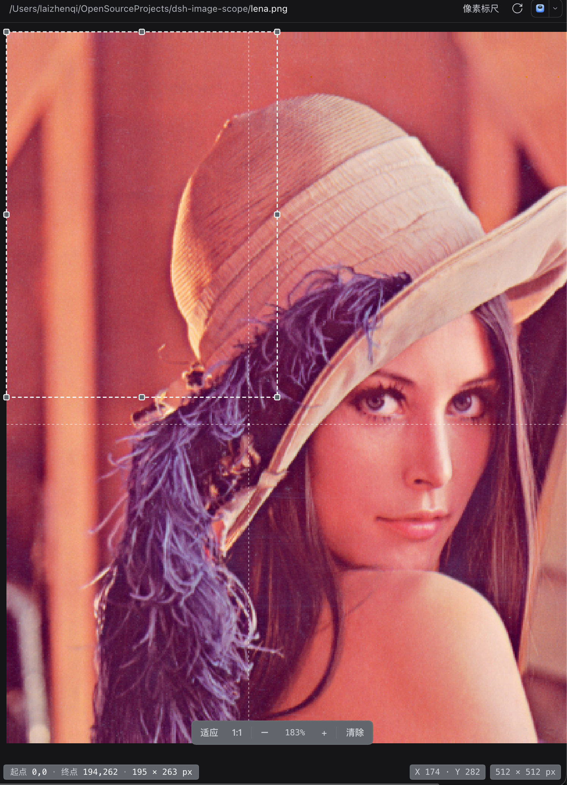

> **开发说明 / Development:** 本分支用于展示与发布说明；如需开发请切到 [`release`](https://github.com/olivine13/dsh-image-scope/tree/release) 分支。 / This branch is the landing page; switch to the `release` branch for development.

<p align="center"></p>

# dsh-image-scope

[English](README.md) · [GitHub](https://github.com/olivine13/dsh-image-scope) · [问题反馈](https://github.com/olivine13/dsh-image-scope/issues) · [npm](https://www.npmjs.com/package/dsh-image-scope)

给 DeepSeek Harness（DSH）右侧栏的图片预览加一把像素标尺：悬浮读取鼠标下的像素坐标，拖出一个虚线选框测量区域，任何缩放比例下坐标和宽高都按图片真实像素计算。

用于开发与设计校验：对比截图、检查间距、量图标尺寸，或确认某个像素的值。

## 截图

<p align="center"></p>

从 `(0,0)` 到 `(194,262)` 的虚线选框，左下角显示 **195 × 263 px**；指针位置 `X 174 / Y 282`；图片为 **512 × 512 px**，当前查看比例 **183%**。任何缩放下测量值都按图片真实像素计算。

## 功能

- **悬浮读数** — 右下角显示 X/Y 坐标，并画出十字准线与当前像素格。
- **单个测量选框** — 拖动绘制虚线框；在框内拖动可整体移动，拖 8 个手柄可缩放；所有边都会吸附到图片边界。
- **直观的测量结果** — 左下角显示起点像素、终点像素和 `宽 × 高`（按整像素计数）。
- **快捷键** — 查看器有焦点时按 Ctrl+D（macOS 为 ⌘D）清除选框；按 Esc 取消正在进行的绘制、移动或缩放。
- **缩放准确** — 适应 / 1:1 / − / +，以及 Ctrl/⌘ + 滚轮（或触控板捏合）。滚轮缩放以指针为锚点，工具栏缩放以视口中心为锚点；坐标与尺寸始终是图片像素，不是屏幕像素。
- **像素级渲染** — 放大到 150% 及以上时自动切换为像素化渲染。
- **保留内置查看器** — 预览头部的查看器下拉里仍可切回内置「图片」查看器。
- **可配置** — 颜色、字号、框体尺寸与 overlay 样式全部在 `config.json` 中。

## 安装

```sh
dsh plugin add dsh-image-scope
```

如果你不在默认 profile，请加 `--profile <name>`。市场上架后也可以在 **设置 → 插件 → Discover** 中安装。

npm 包：[dsh-image-scope](https://www.npmjs.com/package/dsh-image-scope)。

- `npm install dsh-image-scope` 只下载包，不会在 DSH 中注册插件。
- 用上面的 `dsh plugin add dsh-image-scope` 在 profile 中启用。
- Host 入口：`import { apply } from 'dsh-image-scope'`；浏览器端由 DSH 通过 bundle manifest 从 `dsh-image-scope/client` 加载。

## 使用

1. 在右侧栏打开一张图片（PNG、JPEG、GIF、WebP、BMP、ICO 或 SVG）。
2. 如果查看器下拉里不是 **像素标尺**，手动选一下；图片默认使用该查看器。
3. 鼠标在图片上移动即可读取坐标。
4. 按住左键拖动，画出虚线选框。
5. 在框内拖动可整体移动；拖四角或四边的手柄可缩放；靠近图片边界会自动吸附。
6. 按 Ctrl+D / ⌘D、点「清除」，或直接拖一个新框替换。

坐标以图片左上角为 `(0,0)`；宽高按包含首尾像素计数，例如从 x=100 拖到 x=199，宽度就是 100 px。

## 配置

编辑插件包里的 `config.json`：

| 区块 | 作用 |
|---|---|
| `font` | 字体族、字号、行高 |
| `canvas` | 画布背景/文字色、滚动内边距、聚焦描边 |
| `selection` | 虚线框的颜色、线宽、虚线、填充与透明度 |
| `crosshair` | 十字准线的颜色、透明度、线宽、虚线 |
| `pixel` | 悬停像素格描边 |
| `handle` | 8 个缩放手柄的尺寸、圆角、填充、边框 |
| `selectionInfo` | 左下角测量信息条：位置、宽度、间距、内边距、颜色 |
| `hud` | 右下角提示/图片尺寸条：位置、宽度、间距、颜色 |
| `toolbar` | 缩放条及其按钮、百分比、分隔线 |
| `status` | 加载/错误状态文字 |

Host 端会在每次页面启动时读取该文件并注入浏览器。修改后刷新页面即可生效；如果页面是在插件首次启用前就打开的，会先使用内置默认样式，刷新后以 `config.json` 为准。若刷新后仍不生效，重启一次 DSH，让 Host 半重新加载。

## 兼容性

- DSH：`>=0.2.1-rc.5 <0.3.0-0 || >=0.2.2-rc.1 <0.3.0-0`（已在 `0.2.1-rc.5` 测试）
- 无构建步骤、无运行时依赖、无安装脚本。

查看器依赖文档预览扩展点与 `sidebar.right.tab.document` slot；如果内置文档预览不可用，查看器不会被挂载。

## 隐私

全部在本地运行。插件只读取自己的 `config.json` 和预览已经拿到的图片字节，不向外发送数据，也不访问凭据。

## 开发

纯 JavaScript，无构建步骤。

源码、测试和运行文件在 [`release`](https://github.com/olivine13/dsh-image-scope/tree/release) 分支；本分支只保留展示页和发布用资源。

| 路径 | 作用 |
|---|---|
| `client.js` | 浏览器端查看器、配置合并、样式生成 |
| `index.js` | Host 端：把 `config.json` 注入页面 |
| `config.json` | 颜色、字号、框体、overlay |
| `test/math-test.mjs` | 像素映射、吸附、命中、移动/缩放测试 |

```sh
npm test
```

## 许可证

MIT
